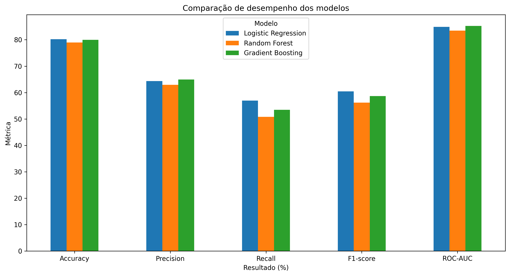
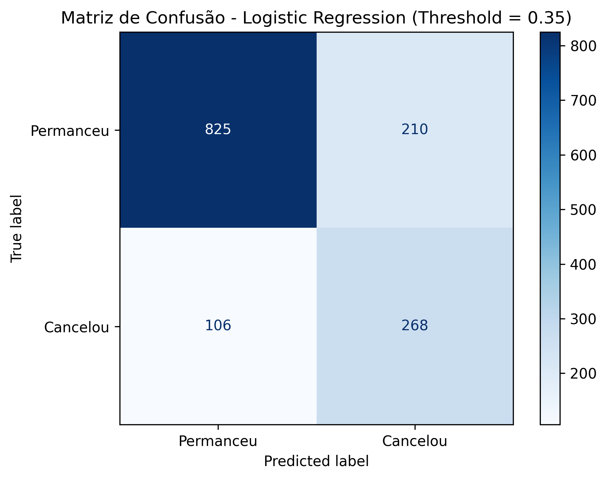
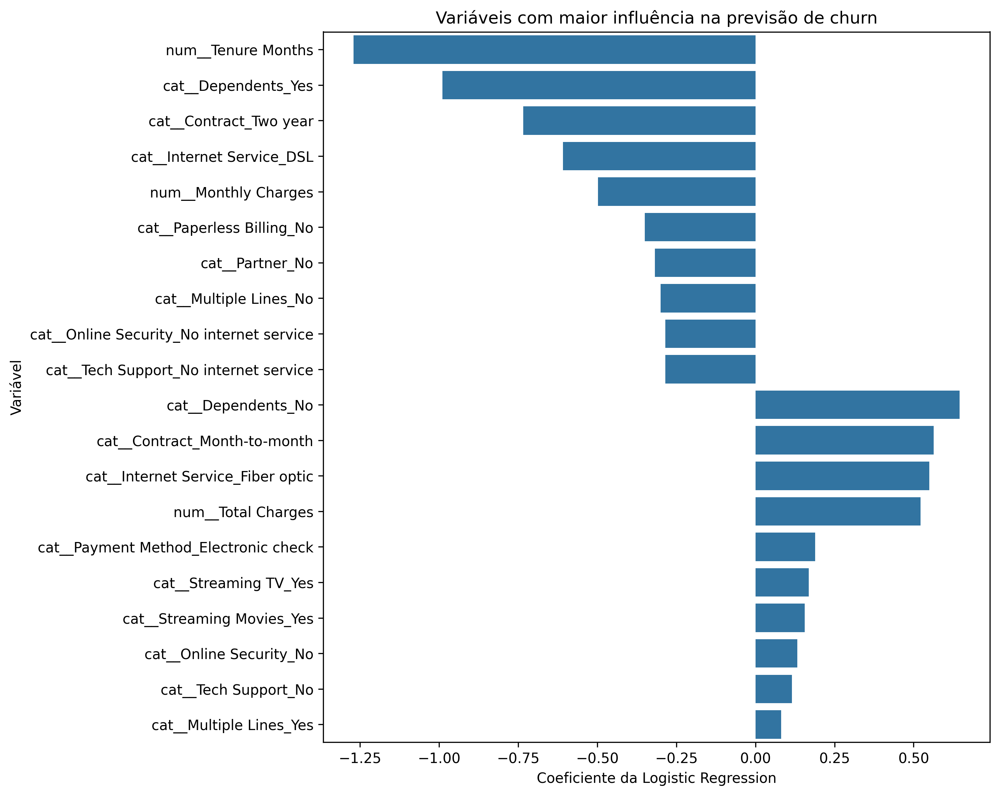

# Telco Customer Churn Prediction

Projeto de Ciência de Dados e Machine Learning desenvolvido com base no conjunto de dados **IBM Telco Customer Churn**, com o objetivo de identificar clientes com maior probabilidade de cancelar os serviços de uma empresa de telecomunicações.

O projeto contempla análise exploratória, preparação dos dados, comparação de modelos de classificação, interpretação dos resultados e ajuste do limiar de decisão com foco em retenção de clientes.

---

## Objetivo do projeto

A rotatividade de clientes, também conhecida como **churn**, representa um desafio relevante para empresas que trabalham com serviços recorrentes.

O objetivo deste projeto é desenvolver um modelo de Machine Learning capaz de identificar clientes com maior risco de cancelamento, permitindo que estratégias de retenção sejam direcionadas de forma mais eficiente.

---

## Problema de negócio

Identificar antecipadamente clientes com maior probabilidade de churn pode ajudar uma empresa a:

- direcionar campanhas de retenção;
- priorizar clientes com maior risco;
- reduzir perdas de receita;
- compreender fatores associados ao cancelamento;
- apoiar decisões estratégicas baseadas em dados.

---

## Tecnologias utilizadas

- Python
- Pandas
- NumPy
- Matplotlib
- Seaborn
- Scikit-learn
- Jupyter Notebook
- Joblib
- Git
- GitHub

---

## Estrutura do projeto

```text
telco-customer-churn/
│
├── data/
│   └── Telco_customer_churn.csv
│
├── images/
│   ├── confusion_matrix.png
│   ├── feature_importance.png
│   └── model_comparison.png
│
├── models/
│   └── .gitkeep
│
├── notebooks/
│   └── telco_churn_analysis.ipynb
│
├── src/
│   ├── preprocessing.py
│   ├── train.py
│   └── evaluate.py
│
├── .gitignore
├── README.md
└── requirements.txt
```

---

## Etapas do projeto

O projeto foi estruturado nas seguintes etapas:

1. Entendimento do problema de negócio
2. Carregamento e inspeção dos dados
3. Limpeza e tratamento dos dados
4. Análise Exploratória de Dados (EDA)
5. Seleção das variáveis
6. Separação entre treino e teste
7. Construção do pipeline de pré-processamento
8. Treinamento dos modelos
9. Avaliação e comparação das métricas
10. Ajuste do threshold
11. Interpretação do modelo
12. Recomendações de negócio
13. Salvamento e reutilização do pipeline treinado

---

# Análise Exploratória de Dados

A análise exploratória revelou padrões importantes associados ao churn.

## Tipo de contrato

Clientes com contratos mensais apresentaram uma taxa de churn significativamente superior aos contratos de maior duração.

| Tipo de contrato | Taxa de churn |
| ---------------- | ------------: |
| Month-to-month   |        42,71% |
| One year         |        11,27% |
| Two year         |         2,83% |

Contratos de maior duração apresentaram maior retenção de clientes.

---

## Tempo de permanência

Clientes que permaneceram na empresa apresentaram tempo médio de relacionamento de:

**37,57 meses**

Enquanto clientes que cancelaram apresentaram:

**17,98 meses**

A mediana também apresentou diferença relevante:

- Permaneceu: **38 meses**
- Cancelou: **10 meses**

Os resultados indicam maior incidência de churn entre clientes com menor tempo de relacionamento com a empresa.

---

## Cobrança mensal

Clientes que cancelaram apresentaram cobrança mensal média de:

**74,44**

Enquanto clientes que permaneceram apresentaram:

**61,27**

Na análise descritiva, cobranças mensais mais elevadas apresentaram associação com maior incidência de churn.

---

## Serviço de internet

| Serviço             | Taxa de churn |
| ------------------- | ------------: |
| Fiber optic         |        41,89% |
| DSL                 |        18,96% |
| No internet service |         7,40% |

Clientes que utilizavam **Fiber optic** apresentaram uma taxa de churn significativamente superior.

---

## Método de pagamento

| Método de pagamento       | Taxa de churn |
| ------------------------- | ------------: |
| Electronic check          |        45,29% |
| Mailed check              |        19,11% |
| Bank transfer (automatic) |        16,71% |
| Credit card (automatic)   |        15,24% |

O método **Electronic check** apresentou a maior taxa de churn entre os métodos analisados.

---

## Serviços adicionais

Clientes sem **Tech Support** apresentaram:

**41,64% de churn**

Enquanto clientes com suporte técnico apresentaram:

**15,17%**

Clientes sem **Online Security** apresentaram:

**41,77% de churn**

Enquanto clientes que possuíam o serviço apresentaram:

**14,61%**

---

# Preparação dos dados

Durante a preparação dos dados foram realizadas as seguintes etapas:

- conversão da variável `Total Charges` para formato numérico;
- análise e tratamento de valores ausentes;
- remoção de identificadores sem valor preditivo;
- prevenção de data leakage;
- remoção de variáveis geográficas de alta granularidade;
- separação das variáveis numéricas e categóricas;
- padronização das variáveis numéricas;
- codificação das variáveis categóricas.

As variáveis numéricas foram tratadas utilizando `StandardScaler`.

As variáveis categóricas foram transformadas utilizando `OneHotEncoder`.

O pré-processamento foi incorporado a um `Pipeline` do Scikit-learn, garantindo que as transformações fossem ajustadas apenas com os dados de treinamento.

---

# Modelos avaliados

Foram avaliados três algoritmos de classificação:

- Logistic Regression
- Random Forest
- Gradient Boosting

## Resultados

| Modelo              | Accuracy |  Precision |     Recall |   F1-score |    ROC-AUC |
| ------------------- | -------: | ---------: | ---------: | ---------: | ---------: |
| Logistic Regression |   80,20% |     64,35% | **56,95%** | **60,43%** |     84,89% |
| Random Forest       |   78,99% |     62,91% |     50,80% |     56,21% |     83,47% |
| Gradient Boosting   |   79,99% | **64,94%** |     53,48% |     58,65% | **85,23%** |

### Comparação visual dos modelos



Embora o Gradient Boosting tenha apresentado o maior ROC-AUC, a Logistic Regression apresentou o maior Recall para a classe de churn.

Como o objetivo principal é identificar clientes em risco de cancelamento, a **Logistic Regression** foi selecionada como modelo de referência.

---

# Ajuste do threshold

Por padrão, a Logistic Regression utiliza um threshold de **0,50**.

Entretanto, em um problema de retenção de clientes, deixar de identificar um cliente que realmente irá cancelar pode representar uma oportunidade perdida.

Por esse motivo, diferentes thresholds foram avaliados.

| Threshold |   Accuracy |  Precision |     Recall |   F1-score |
| --------: | ---------: | ---------: | ---------: | ---------: |
|      0,50 |     80,20% |     64,35% |     56,95% |     60,43% |
|      0,45 |     79,28% |     60,57% |     62,83% |     61,68% |
|      0,40 |     78,35% |     57,93% |     67,38% |     62,30% |
|  **0,35** | **77,57%** | **56,07%** | **71,66%** | **62,91%** |
|      0,30 |     75,87% |     53,24% |     74,60% |     62,14% |

O threshold **0,35** foi selecionado por apresentar um bom equilíbrio entre Recall e F1-score.

---

# Modelo final

Com threshold de **0,35**, a Logistic Regression apresentou:

- Accuracy: **77,57%**
- Precision: **56,07%**
- Recall: **71,66%**
- F1-score: **62,91%**
- ROC-AUC: **84,89%**

No conjunto de teste existiam **374 clientes que realmente apresentaram churn**.

O modelo identificou corretamente:

**268 clientes**

e deixou de identificar:

**106 clientes**

Isso significa que o modelo conseguiu identificar aproximadamente **71,66% dos clientes que realmente cancelaram o serviço**.

### Matriz de confusão do modelo final



---

# Interpretação do modelo

A análise dos coeficientes da Logistic Regression permitiu identificar características associadas a maior ou menor probabilidade estimada de churn.

Entre as características associadas a maior probabilidade de churn estão:

- ausência de dependentes;
- contrato `Month-to-month`;
- serviço de internet `Fiber optic`;
- utilização de `Electronic check`;
- ausência de `Online Security`;
- ausência de `Tech Support`.

Por outro lado, algumas características apresentaram associação com menor probabilidade estimada de churn:

- maior tempo de permanência;
- contratos de dois anos;
- utilização de DSL;
- presença de dependentes.

### Variáveis com maior influência no modelo



Os coeficientes representam associações identificadas pelo modelo e não devem ser interpretados como relações causais.

---

# Recomendações de negócio

Com base na análise exploratória e no modelo preditivo, algumas estratégias podem ser consideradas.

## 1. Incentivar contratos de maior duração

Clientes com contratos mensais apresentaram churn de **42,71%**, enquanto clientes com contratos de dois anos apresentaram apenas **2,83%**.

A empresa pode avaliar benefícios ou condições comerciais para incentivar contratos de maior duração.

## 2. Criar ações nos primeiros meses

Clientes que cancelaram apresentaram tempo médio de relacionamento significativamente menor.

Ações de acompanhamento durante os primeiros meses podem ajudar a identificar dificuldades e melhorar a experiência do cliente.

## 3. Investigar clientes de fibra óptica

Clientes com fibra óptica apresentaram churn de **41,89%**.

Fatores como preço, estabilidade, qualidade e percepção de valor podem ser investigados.

## 4. Incentivar serviços adicionais

Clientes sem suporte técnico e sem segurança online apresentaram taxas de churn superiores a **41%**.

Ofertas de serviços adicionais podem contribuir para aumentar a percepção de valor.

## 5. Avaliar clientes que utilizam Electronic Check

Clientes que utilizavam `Electronic check` apresentaram churn de **45,29%**.

Esse grupo pode ser priorizado em análises e estratégias de retenção.

## 6. Utilizar o modelo como score de risco

A probabilidade gerada pela Logistic Regression pode ser utilizada como um **score de risco de churn**.

Isso permite que equipes de retenção priorizem clientes com maior probabilidade estimada de cancelamento.

---

# Como executar o projeto

## 1. Clone o repositório

```bash
git clone https://github.com/Jv-ghost/telco-customer-churn.git
```

## 2. Entre na pasta

```bash
cd telco-customer-churn
```

## 3. Crie um ambiente virtual

```bash
python -m venv .venv
```

## 4. Ative o ambiente virtual

### Windows

```bash
.venv\Scripts\activate
```

No Git Bash:

```bash
source .venv/Scripts/activate
```

## 5. Instale as dependências

```bash
pip install -r requirements.txt
```

## 6. Treine o modelo

```bash
python src/train.py
```

## 7. Avalie o modelo

```bash
python src/evaluate.py
```

---

# Dataset

O conjunto de dados utilizado neste projeto é o **IBM Telco Customer Churn**, contendo informações relacionadas ao perfil dos clientes, serviços contratados, contratos, formas de pagamento, valores cobrados e status de churn.

---

# Autor

**João Vitor Duarte de Oliveira**

Projeto desenvolvido para fins de portfólio e aplicação prática de técnicas de Ciência de Dados e Machine Learning.
